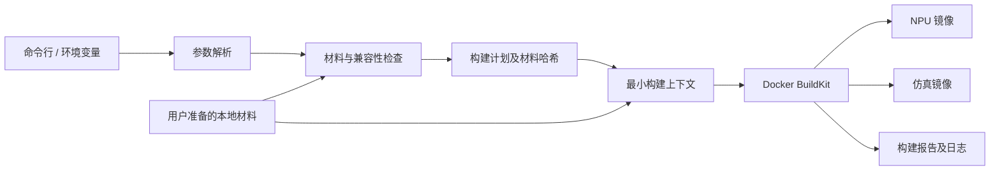

# ascend-dev 容器构建工具设计

状态：首版已实现，已完成本地脚本及替身流程测试；真实镜像、NPU 和 CAModel 待验收。日期：2026-10-28。

## 1. 目标与职责

将用户准备好的本地安装材料转换为可追溯的 Ascend 开发镜像，提供 `npu` 和 `simulation` 两种构建目标。同一组构建参数可用于预览、检查和实际构建，并通过简短示例脚本复用。

工具负责：

- 生成下载及存放指引，检查本地材料是否齐全、匹配。
- 解析配置、选择构建目标、安装容器内依赖、生成镜像。
- 执行不依赖 NPU 的镜像构建检查，输出日志、解析后的配置和构建清单。
- 将 CANN 与可选仿真环境的加载逻辑写入镜像入口和 Bash 配置。

职责之外：安装包下载、断点续传、服务器上传、宿主机驱动/固件安装、设备分配、容器日常启停、业务代码编译和算子正确性/性能测试。仅提供运行说明、Compose 示例及账号副本准备示例，不在构建工具中实现 `run`、`exec`、`compose up` 等生命周期命令。

构建不要求宿主机有 NPU。最终镜像的真机验证由使用方在具备驱动、设备和挂载条件的服务器上完成。

“不管理下载”具体约定：CANN、Torch wheel、CAModel 和基础镜像由用户事先准备；默认构建允许 APT/PIP 安装系统包和附加 Python 依赖，这属于镜像安装步骤，不提供独立下载管理器。完全离线构建作为后续能力，需要额外准备完整依赖及构建器资源。

## 2. 参考实现与调整

参考目录：`/Users/fanghaolei/Workplace/Markdown/gpu_arch/ascend-dev`。

| 参考文件 | 沿用的设计 | 本工具的调整 |
| --- | --- | --- |
| `environment/build-image.sh` | 本地材料检查、构建前失败、目标选择 | 保留直接的 Bash 流程，用少量具名函数整理检查与构建 |
| `environment/Dockerfile` | 公共层、NPU/仿真两个目标、只读挂载安装材料 | 分离 APT/PIP 源，精确锁定 wheel，增加产物清单 |
| `environment/shell-env.sh` | 入口及 Bash 共用环境脚本 | 将 CANN 加载路径交由版本配置描述，避免跨版本硬编码 |
| `environment/prepare-simulation.sh` | 解压、执行初始化脚本 | 显式列出压缩包，不限制全目录恰好两个 ZIP |
| `environment/docker-compose.yaml` | 展示驱动与设备来自宿主机 | 只用于运行文档，不纳入构建配置 |

首个候选环境沿用参考资料：Ubuntu 22.04、linux/amd64、容器 Python 3.10、CANN 9.1.0、PyTorch 2.10.0+cpu、torch-npu 2.10.0.post4、SoC 950。该软件版本组合可在官方配套表中查到；具体 SoC 安装材料、编译链、驱动配套与 CAModel 仍须分别验收，不能因此标记为真机或仿真已验证。[官方版本配套](https://github.com/Ascend/pytorch/blob/master/COMPATIBILITY.md)

参考脚本接受其他 SoC 字符串以及 Torch 2.7.1，不代表这些组合已经验证。新工具不把任意字符串参数等同于支持承诺。

## 3. 技术结构与脚本约束

首版使用 **Bash + Dockerfile**。Bash 负责参数、材料检查、临时上下文和 Docker 调用；Dockerfile 与少量脚本承担容器内安装。复用参考实现，不引入 Python CLI、TOML/YAML 解析器或通用配置框架。容器内已有的 Python 可用于检查安装后的 Python 包。

**新增约束：脚本内容必须清晰，同时保持适度精简。清晰优先于压缩行数，精简通过控制职责、消除重复和减少不必要的抽象实现。**

- 主流程按“解析参数 → 校验 → 选择材料 → 展示计划 → 准备上下文 → 构建 → 输出结果”排列，从文件末尾的 `main` 能直接看懂执行顺序。
- 使用明确的变量名及具名函数；一个函数处理一件可描述的事。参数解析使用普通 `case`，Docker 参数使用 Bash 数组，避免 `eval`、动态变量名和多层间接调用。
- 共享错误处理、文件选择和版本检查；只有出现实际重复或明显独立的职责时才拆函数/文件。宿主机首版优先一个主脚本，必要时增加一个 `lib/common.sh`，不预建模块目录体系。
- 安装步骤在 Dockerfile 中直接可见；仅将复杂或需要复用的操作抽成容器脚本。NPU 与仿真入口若只是模式不同，共用入口并按模式加载环境。
- 注释解释约束、特殊包命名和环境加载原因；不逐行复述命令。帮助信息集中维护，错误信息包含参数、实际值和修正方式。
- 不以超长单行、嵌套三元式、密集管道或晦涩 Shell 技巧缩短代码。关键检查、路径引用、退出码和清理逻辑不可因精简省略。
- 主脚本以约 200～300 行为初始规模参考，超过后先检查是否引入过多功能或重复；不是硬上限，不通过挤行或机械拆文件达标。
- 使用 `set -euo pipefail`、带引号的路径和 `trap` 清理；仍显式处理预期失败和构建管道退出码，不把可靠性完全交给 `set -e`。
- 首版优先兼容 Bash 3.2+ 的常用语法，不使用关联数组等高版本特性；宿主机依赖 Bash、Docker 和常见文件工具，SHA-256 工具兼容 `sha256sum` / `shasum -a 256`。



建议目录：

```text
ascend_dev/
├── build-image.sh       # 参数、检查、材料选择与 Docker 编排
├── Dockerfile           # 公共层、NPU 和仿真目标
├── scripts/
│   ├── entrypoint.sh     # 共用容器入口
│   ├── shell-env.sh      # CANN / 仿真环境加载
│   └── prepare-simulation.sh
├── examples/            # 常用参数组合的简短调用脚本
├── docs/                # 下载指导、版本配套和运行说明
└── tests/               # 有意义的失败场景及构建验证
```

上述目录是职责布局，不要求为占位而创建文件。脚本通过自身位置定位 Dockerfile 与配套脚本，从任意工作目录调用均可。

## 4. 命令设计

下列接口已在首版脚本中实现。

| 命令 | 用途 | 访问 Docker / 执行构建 |
| --- | --- | --- |
| `bash build-image.sh --help` | 参数说明和使用示例 | 否 |
| `bash build-image.sh <环境参数> --materials` | 列出所需材料、下载入口、预期文件名与保存位置 | 否 |
| `bash build-image.sh <环境参数> --dry-run` | 显示有效参数、预期材料、构建目标与命令 | 否；材料缺失标记 unresolved |
| `bash build-image.sh <环境参数> --check` | 检查材料、版本、架构及 Docker 构建条件 | 访问 Docker，不构建 |
| `bash build-image.sh <环境参数> --check --files-only` | 仅检查本地材料 | 否 |
| `bash build-image.sh <环境参数>` | 自动执行完整检查并构建 NPU 镜像 | 是 |
| `bash build-image.sh <环境参数> --target simulation` | 构建仿真镜像 | 是 |

`--materials`、`--dry-run`、`--check` 为互斥模式，`--files-only` 只用于检查模式。预览不是“检查通过”的替代物；构建前必须解析到唯一且实际存在的输入文件。默认复用缓存，不自动拉取基础镜像，不推送远程仓库。

参数使用直观的长选项；列表使用重复参数，例如多个 `--camodel-archive`、`--apt-package`、`--pip-package`，内部用数组存储。未知参数、缺失值和错误格式立即报错，不提供通用 `--set` 或任意 Docker 参数透传。

输出镜像的仓库名与 tag 均由工具自动生成，不提供 `--tag`、镜像名称覆盖参数或对应环境变量；传入 `--tag` 按未知参数报错。生成规则见第 10 节。`--base-image` 只选择输入基础镜像，不改变输出命名规则。

优先级从低到高为：默认值 → 文档列出的 `ASCEND_DEV_*` 环境变量 → CLI。标量参数重复指定时最后一次生效，方便覆盖示例脚本中的默认参数；列表参数按调用顺序追加。环境变量仅覆盖常用标量，避免实现两套列表解析规则。常用组合通过 `examples/*.sh` 展示，不引入配置文件继承。

显式路径相对调用目录解析；按约定查找的材料相对指定根目录解析。示例脚本按自身位置定位主脚本，并通过 `"$@"` 转发额外参数，不依赖调用者先进入仓库。

## 5. 参数模型

### 5.1 环境与材料参数

| 参数 | 默认值 / 必填条件 | 说明 |
| --- | --- | --- |
| `--target npu\|simulation` | `npu` | 决定最终镜像目标，不决定 SoC 或组件版本 |
| `--soc MODEL` | 必填 | 如 `950`、`910b`；规范化大小写后核对 ops 型号，支持范围以实际适配为准 |
| `--cann-version VERSION` | 必填 | Toolkit 与 ops 的精确版本，不使用“最新”隐式默认值 |
| `--torch-version VERSION` | Torch 启用时必填 | 完整 wheel 版本，如 `2.10.0+cpu`；目录选择使用其基础版本 `2.10.0` |
| `--torch-npu-version VERSION` | Torch 启用时必填 | 完整安装包版本，如 `2.10.0.post4`；不由 Torch 版本推断 `.postN` |
| `--no-torch` | 默认安装 Torch 与 torch-npu | 只安装 CANN 及开发工具，两类目标均可使用；与 Torch 专用参数同时出现时报冲突 |
| `--base-image IMAGE` | `ubuntu:22.04` | 必须已在本机 Docker 中；首版要求 Ubuntu 22.04 / amd64 / Python 3.10，不开放任意 OS/Python 参数 |
| `--materials-root DIR` | 无隐式搜索目录 | 使用第 6 节统一布局；若所有必需材料均由其他路径参数指定，可省略 |
| `--cann-root DIR` | 可选 | 兼容旧布局 `<DIR>/<soc>/<cann-version>/`，优先于统一材料根目录 |
| `--torch-root DIR` | 可选 | 兼容旧布局 `<DIR>/<torch基础版本>/`，优先于统一材料根目录 |
| `--toolkit FILE`、`--ops FILE` | 可选 | 精确指定 `.run`，分别覆盖目录选择结果；仍校验版本、型号及架构 |
| `--torch-wheel FILE`、`--torch-npu-wheel FILE` | 可选 | 精确指定 wheel，分别覆盖目录选择结果；版本参数仍须显式提供 |

材料查找优先级：精确文件路径 → 对应组件根目录 → 统一材料根目录。只在选定目录内按当前版本查找，不逐层回退到其他目录，不扫描整个磁盘；一个必需材料匹配到多个文件时报错。

### 5.2 仿真专用参数

| 参数 | 默认值 / 必填条件 | 说明 |
| --- | --- | --- |
| `--camodel-dir DIR` | 仿真目标必填 | 指定仿真输入根目录；不从 CANN 版本自动推断 CAModel 位置 |
| `--camodel-archive FILE` | 仿真目标至少指定一次 | 可重复；相对路径以 CAModel 目录为基准，按指定顺序解压；不扫描所有 ZIP |
| `--camodel-init FILE` | `<CAModel目录>/init.sh`，必须存在 | 构建时在 `/opt/CAModel` 下执行，已加载 CANN 环境 |
| `--camodel-env FILE` | 自动使用 CAModel 目录中存在的 `env.sh` | 容器入口及 Bash 加载；缺省文件不存在可忽略，显式指定却不存在则报错 |
| `--camodel-check FILE` | 默认不执行额外仿真自检 | 镜像构建末尾执行无设备自检；未提供时报告“仿真功能未验证” |

上述 FILE 参数都可用绝对路径；仿真专用 FILE 的相对路径统一以 `--camodel-dir` 为基准，区别于通用文件参数的调用目录基准。NPU 目标不接受这些参数。压缩包名由提供方决定，示例中的 `model.zip` / `tools.zip` 只是占位名。

### 5.3 构建及扩展参数

| 参数 | 默认值 | 说明 |
| --- | --- | --- |
| `--workdir DIR` | `/workspace` | 镜像内工作目录，不创建宿主机挂载 |
| `--apt-mirror URL` | 保留基础镜像 APT 源 | 替换 Ubuntu 软件仓库基础地址；不影响 PIP |
| `--pip-index URL` | `https://pypi.org/simple` | 构建时安装附加 Python 依赖的源 |
| `--apt-package PACKAGE` | 仅安装必要系统依赖 | 可重复，追加系统包，包名可带 APT 版本约束 |
| `--pip-package SPEC` | 仅安装必要 Python 依赖 | 可重复，追加 PIP 依赖；Shell 调用时给包含比较运算符的约束加引号 |
| `--pip-constraints FILE` | 无附加约束文件 | 与工具生成的核心版本约束共同生效，冲突时报错 |
| `--post-install FILE` | 无 | 公共环境安装后、CAModel 初始化前执行的本地 Bash 脚本，执行后核对核心版本；不在宿主机执行 |
| `--no-cache` | 复用构建缓存 | 禁用 Docker 步骤缓存；不清空本机其他缓存 |
| `--progress plain\|auto\|tty` | `plain` | Docker 构建输出格式 |
| `--network default\|none` | `default` | 控制 Docker RUN 网络；`none` 不代表已实现完整离线构建 |
| `--output-dir DIR` | 调用目录下的 `build` | 每次创建独立子目录，保存日志、材料哈希和结果 |
| `--allow-unverified` | 关闭 | 只允许配套表未记录的组合，不跳过文件、架构、版本一致性和已知冲突检查 |

`--materials`、`--dry-run`、`--check`、`--files-only` 与 `--help` 的行为见第 4 节。除下载指引和预览外，构建或完整检查要求材料已准备；`--check --files-only` 不访问 Docker。所有实际构建默认先完整检查，无需先手动执行 `--check`。

首版支持的环境变量限定为 `ASCEND_DEV_TARGET`、`ASCEND_DEV_SOC`、`ASCEND_DEV_CANN_VERSION`、`ASCEND_DEV_TORCH_VERSION`、`ASCEND_DEV_TORCH_NPU_VERSION`、`ASCEND_DEV_BASE_IMAGE`、`ASCEND_DEV_MATERIALS_ROOT`、`ASCEND_DEV_CAMODEL_DIR`。其余选项使用 CLI；不读取参考脚本的无前缀同名环境变量，避免无意继承外部配置。

扩展优先采用明确的参数或本地脚本，避免为潜在需求构建插件系统。私有源凭据需求另用 BuildKit secret 设计，不放入普通镜像参数。

### 5.4 NPU 镜像命令示例

使用推荐材料目录，构建包含 CANN、Torch 与 torch-npu 的 NPU 开发镜像：

```bash
bash build-image.sh \
  --target npu \
  --soc 950 \
  --cann-version 9.1.0 \
  --torch-version 2.10.0+cpu \
  --torch-npu-version 2.10.0.post4 \
  --materials-root /data/ascend-materials
```

不传设备编号、驱动目录或业务代码路径。它们属于容器运行条件，不参与镜像制作。

### 5.5 仿真镜像命令示例

同一套公共组件，增加 CAModel 输入，不要求预先构建上面的 NPU 镜像：

```bash
bash build-image.sh \
  --target simulation \
  --soc 950 \
  --cann-version 9.1.0 \
  --torch-version 2.10.0+cpu \
  --torch-npu-version 2.10.0.post4 \
  --materials-root /data/ascend-materials \
  --camodel-dir /data/ascend-materials/camodel/950/9.1.0 \
  --camodel-archive model.zip \
  --camodel-archive tools.zip \
  --camodel-init init.sh \
  --camodel-env env.sh
```

这里显式指定了 init/env，便于看清作用；若使用默认名称，可省略这两项。若已有供应方提供的 `check.sh`，追加 `--camodel-check check.sh`；其失败会终止构建。不承诺所有 CAModel 都通过 Torch 运行，也不使用 NPU 可用性作为仿真自检标准。

### 5.6 检查、兼容布局与精简构建

在任一完整构建命令末尾追加 `--materials` 查看下载及存放指引，追加 `--dry-run` 预览，或追加 `--check` 检查后退出；追加 `--check --files-only` 仅检查材料。这些模式均不制作镜像。

复用参考目录的旧材料布局：

```bash
bash build-image.sh \
  --soc 950 \
  --cann-version 9.1.0 \
  --torch-version 2.10.0+cpu \
  --torch-npu-version 2.10.0.post4 \
  --cann-root /home/user/cann-run \
  --torch-root /home/user/cann-run/torch \
  --check
```

只需要 CANN 编译开发环境时，移除 Torch 专用参数并使用 `--no-torch`：

```bash
bash build-image.sh \
  --target npu \
  --soc 950 \
  --cann-version 9.1.0 \
  --materials-root /data/ascend-materials \
  --no-torch
```

如材料未按推荐布局存放，可在命令中用 `--toolkit /path/toolkit.run`、`--ops /path/ops.run`、`--torch-wheel /path/torch.whl` 和 `--torch-npu-wheel /path/torch_npu.whl` 分别指定真实文件。示意路径不能代替支持的官方包名，精确路径也不能绕过版本检查。

## 6. 材料管理与下载指导

默认建议将大文件放在仓库外，不提交 Git，也不扫描整个磁盘猜测位置：

```text
/data/ascend-materials/
├── cann/9.1.0/linux-amd64/
│   ├── Ascend-cann-toolkit_9.1.0_linux-x86_64.run
│   └── Ascend-cann-950-ops_9.1.0_linux-x86_64.run
├── torch/2.10.0/cp310/linux-amd64/
│   ├── torch-2.10.0+cpu-cp310-cp310-manylinux_2_28_x86_64.whl
│   └── torch_npu-2.10.0.post4-cp310-cp310-manylinux_2_28_x86_64.whl
└── camodel/950/9.1.0/
    ├── model.zip
    ├── tools.zip
    ├── init.sh
    └── env.sh
```

这里只是推荐布局，显式路径可以指向任意可读本地目录。`model.zip` / `tools.zip` 为占位示例；CAModel 的实际名称、版本、获取渠道及初始化方式由提供方决定，不能由 CANN 版本推断。

兼容参考仓库已有的 `cann-run/<soc>/<version>/` 与 `cann-run/torch/<version>/`：通过 `--cann-root`、`--torch-root` 或精确文件路径选择，不复制或重命名用户原文件。Torch 目录按基础版本查找，实际 wheel 仍按完整版本检查。

`--materials` 按当前参数输出如下信息，即使材料尚不存在也能使用：

| 材料 | 获取入口与指导 | 保存位置 |
| --- | --- | --- |
| 基础镜像 | 指定镜像名、平台及用户手动准备的 `docker pull --platform linux/amd64 ubuntu:22.04` 或 `docker load` 示例 | Docker 本机镜像存储 |
| Toolkit / ops | 官方 CANN 下载入口、精确版本与型号；文档可附参考直链及核对日期 | `cann/<version>/<platform>/` |
| Torch | 官方 CPU wheel 索引，提示 Python ABI 与平台标签 | `torch/<version>/<abi>/<platform>/` |
| torch-npu | 官方发行页、完整安装包版本、配套表 | 同上 |
| CAModel | 用户/供应方渠道说明，逐项列出清单及脚本要求 | `camodel/<soc>/<version>/` |

官方入口：[CANN 下载](https://www.hiascend.com/developer/download/community/result?module=cann)、[PyTorch CPU wheels](https://download.pytorch.org/whl/cpu/torch/)、[torch-npu 发行页](https://gitcode.com/Ascend/pytorch/releases)。参考目录 README 包含首个候选版本的精确文件名和直链；下载文档从这些资料整理，直链有效性需独立核对，工具不按版本字符串盲目拼接下载 URL。

缺失时报出“需要什么、预期在哪里、如何显式覆盖、从哪个入口获取”。只要求当前目标、SoC 和框架选择真正需要的文件，不要求下载其他型号的 ops。

## 7. 构建检查与兼容性

分三层处理，防止“文件名看起来对”被误认为“环境已经可用”。

**配置与材料检查（可离线执行）：**

1. 验证未知参数、必填项和目标条件；候选文件必须唯一，不取第一个匹配项。
2. 检查文件存在、可读、非空，获取大小与 SHA-256；有可信上游摘要时比对，否则记录为本地指纹，不宣称来源校验通过。
3. 验证 Toolkit/ops 版本、SoC 与架构；首版只处理已明确的命名格式，遇到其他格式报错并说明支持范围。
4. 宿主机使用简单、具名的匹配逻辑检查 wheel 完整版本、cp310 ABI 和 x86_64 平台；不在 Bash 中重写通用 Python 版本或 wheel 解析库。manylinux/glibc 条件由容器内 pip 的目标环境检查处理，安装后再核对包元数据与精确版本。
5. 仿真目标检查显式压缩包清单、重复解压目录及越界路径；脚本在镜像中执行 `bash -n`，宿主机不执行用户初始化脚本。

**构建能力检查：**

- 检查 Docker CLI、daemon、BuildKit 以及所需 Dockerfile 指令是否可用。
- 首版固定使用本机默认 Docker builder；检查本地基础镜像的 OS/架构。基础镜像不能仅凭引用名称认定为 Ubuntu 22.04，实际系统和 Python 版本在构建早期再次检查。
- 构建主机平台与目标不一致时给出说明；跨架构执行要求用户已有对应模拟能力，不自动安装 QEMU，不把 macOS 上的构建成功当作设备验证。
- CANN `.run --check` 在构建容器内执行，随后才安装；不在宿主机执行安装器。

**兼容性记录：**

版本配套先用一份文档表记录 CANN、torch-npu 完整安装包版本、PyTorch、Python、OS、架构和 SoC，附来源、核对日期及独立状态：`documented`（官方配套）、`image-tested`（镜像构建通过）、`device-tested`、`simulation-tested`。脚本只维护少量明确支持的软件版本组合，不实现通用兼容性规则引擎。

已知不兼容的组合直接阻止构建；没有记录的组合要求显式 `--allow-unverified`，报告标为未验证。该参数只放行“缺少配套记录”，不能绕过材料损坏、ABI/架构错误或已知冲突。添加新版本时补充文档和必要的具名安装函数；确有多套安装流程后再考虑抽取适配器。

torch-npu 的 `.postN`、`.devN`、`rc` 等属于具体包版本，必须保留；TorchNPU 产品发行版本与安装包版本分别记录，不能混用。[官方命名与配套说明](https://github.com/Ascend/pytorch/blob/master/COMPATIBILITY.md)

## 8. Docker 构建分层

```text
base-os → system-deps → cann
                                       ├─ Torch 启用：torch-install → dev-common
                                       └─ Torch 关闭：cann-only ───→ dev-common
                                                                    ├─ npu
                                                                    └─ simulation
```

实际 Dockerfile 使用明确的阶段别名表达可选 Torch 分支。CANN 层位于 Torch 层之前，CANN 和 Torch 使用独立的材料挂载目录，使切换 Torch 时可复用 CANN 安装缓存；首个版本需用真实安装包确认 CANN 安装器不依赖 Torch。

- `system-deps`：编译工具、Python、CANN 所需系统库，配置 APT 源。
- `cann`：只读挂载选定 `.run`，执行包检查与安装。实现中保留完整安装层，不再跨阶段仅复制 `/usr/local/Ascend`，避免遗漏系统集成文件；挂载的原始安装包仍不进入镜像层。
- `torch-install`：挂载选定 wheels，安装并精确验证包版本，执行 `pip check`；附加依赖使用 constraints 保护核心版本。
- `dev-common`：工作目录、统一环境入口、扩展脚本。运行时允许 Compose 指定 UID/GID；入口不依赖 root，已安装组件的必要文件对运行用户可读、可执行。扩展后再检查，防止脚本破坏核心依赖。
- `npu`：交付开发镜像；驱动、设备节点及宿主机业务目录不进入镜像。
- `simulation`：在一个阶段中挂载 ZIP、解压并初始化，设置仿真模式，加载运行时 `env.sh`，执行可选无设备自检；原始 ZIP 不进入镜像层。

保留参考实现的 BuildKit 只读挂载方式。它可以让安装器读取构建上下文中的材料，而不通过 `COPY` 将原始安装包写入镜像层。[Docker bind mount 说明](https://docs.docker.com/reference/dockerfile/#run---mounttypebind)

首版使用按需收集的临时上下文，绝不把整个材料库或整个业务仓库发给 Docker；只复制所选文件，正常结束或失败均清理临时目录，保留日志。后续可用 named contexts 减少宿主机临时副本，仍须控制可访问材料范围。[Docker named contexts](https://docs.docker.com/build/concepts/context/#named-contexts)

## 9. 仿真适配与环境加载

仿真输入契约：压缩包列表、构建期初始化脚本、可选运行期环境脚本、可选自检脚本。首版按参考资料将包解压到 `/opt/CAModel/<压缩包去掉扩展名>/`，在 `/opt/CAModel` 下执行 `bash ./init.sh`，设置 `CAMODEL_HOME=/opt/CAModel`；定制目录整理交给初始化脚本。

初始化脚本仅修改镜像内文件；其中 `export` 不会自动保留到运行时，所需变量应进入 `env.sh` 或显式镜像 `ENV`。若提供方的 init 脚本包含下载步骤，应先将其改为消费本地材料，再接入本工具。

不预设所有 CAModel 都能通过 `torch_npu` 或同一条仿真命令执行。自检脚本应验证该包的启动程序、库加载与最小仿真任务；尚无这些材料时只能完成输入契约和镜像安装设计，不能宣称已实现功能验证。

统一提供 `/etc/ascend/environment.sh`，按配置先加载 CANN，再按目标加载仿真配置。入口使用 `exec` 启动用户命令，Bash 的交互/登录入口复用同一脚本。环境加载可重复调用且不重复追加搜索路径。

`docker exec <container> python3 ...` 不会重新执行镜像入口；运行文档指导使用镜像提供的环境包装入口或 `bash -lc`。不会用 `torch.npu.is_available()` 判断无 NPU 的镜像构建或仿真环境是否成功。

## 10. 产物与可复现程度

输出镜像名称完全自动生成，仓库名固定为 NPU 的 `ascend-dev` 和仿真的 `ascend-sim`，tag 格式如下：

```text
ascend-dev:npu-cann<CANN>-<SOC>-torch<TORCH>-npu<TORCH_NPU>-py310-amd64-<HASH12>
ascend-sim:sim-cann<CANN>-<SOC>-torch<TORCH>-npu<TORCH_NPU>-py310-amd64-<HASH12>
```

完整 Torch 版本中的 `+` 统一替换为 `_`，如 `2.10.0+cpu` 在 tag 中写为 `2.10.0_cpu`；SoC 使用小写。`--no-torch` 时将 `torch<TORCH>-npu<TORCH_NPU>` 替换为 `cann-only`。`HASH12` 为输入 SHA-256 指纹的前 12 位，不使用时间戳、随机数或自动 `latest` 别名。

同一有效输入得到同一名称；材料、仿真脚本或其他有效构建输入变化时，由指纹区分。输出名在构建前及结束后展示，并写入报告；预览时若材料尚未解析，短码显示为待确定，不伪造最终 tag。用户不能通过参数或环境变量自定义输出名称。

指纹来自按固定顺序输出的有效参数、材料内容哈希、Dockerfile/脚本内容和基础镜像标识；排除绝对路径、日志目录、进度显示及缓存开关等不影响镜像内容的值。完整 Torch 版本（含 `+cpu`）保存在清单；短码用于区分不同输入。不为生成指纹引入通用配置序列化模块。

每次构建输出到 `build/<build-id>/`：

| 文件 | 内容 |
| --- | --- |
| `manifest.txt` | 有效参数、基础镜像 ID/可用 digest、模板和输入指纹；不含凭据 |
| `image-ref.txt` | 构建成功后写入完整自动生成的镜像引用，单独一行，供用户传给 Compose |
| `materials.sha256` | 选定材料与构建脚本的内容哈希 |
| `build.log` | Docker 构建日志 |
| `result.txt` | 成败、失败阶段、镜像 ID、tag、检查结果及未验证项 |
| `installed-packages.txt` | 系统和 Python 实际安装版本，由容器内现成工具输出 |

镜像内保存不含宿主机绝对路径的材料/版本清单，并写入版本及输入指纹 labels。构建失败也输出报告，返回非零状态；只清理本次临时目录，不执行全局 `docker system prune`。

首版报告使用固定格式的文本和 SHA-256 清单，供人工查看，不作为可执行配置加载。JSON 报告、输入锁定重放和复杂配置格式暂不实现。

在线 APT/PIP 源会变化，因此相同输入指纹表示同一构建意图，不保证产物逐字节相同。报告记录实际安装版本；严格复现需要固定基础 digest、APT 快照/精确包版本和完整 Python 依赖闭包。后续增加锁定重放时，必须核对并拒绝变化的材料。

## 11. 网络与离线扩展

首版默认策略：使用本地基础镜像与核心安装材料，允许系统依赖安装联网；不替用户下载 CANN、Torch 或 CAModel，不隐式 `docker pull`。

第二阶段提供完整离线模式，要求用户准备：基础镜像、Dockerfile frontend/构建器所需镜像、适用 OS/架构的 APT 依赖闭包或已含系统依赖的基础镜像，以及完整 Python wheelhouse。指导命令列出缺项，工具不代替用户收集材料。

离线模式下使用 `--network=none` 控制构建步骤，PIP 使用 `--no-index --find-links`，APT 只使用本地源；此外还要禁止基础镜像及 frontend 的远端解析/获取。仅设置 RUN 的网络策略并不能覆盖所有构建器网络访问。离线验收必须在外网不可用、所需构建资源已预置的条件下进行。[Docker RUN 网络语义](https://docs.docker.com/reference/dockerfile/#run---networknone)

首版如暴露 `--network none`，仅表示 Docker RUN 网络选项，不标为完整离线模式；依赖未准备齐时直接失败。

## 12. 验收和实施顺序

### 首版

1. 整理参考 Bash 主脚本、参数帮助、首个调用示例和材料目录指导。
2. 完成 `--materials / --dry-run / --check`，覆盖缺失文件、多个候选、版本混搭、ABI/架构错误、post 版本差异。
3. 整理 NPU Docker 分层和共用入口，实现构建、日志、材料哈希与文本报告。
4. 接入显式 CAModel 清单、初始化/环境脚本，构建仿真目标。
5. 补充真实材料验收、下载指引和运行注意事项。

首版验收标准：

- 无 Docker 时能查看帮助、材料指引及构建计划。
- 材料有误时在昂贵的安装步骤之前报出具体原因；不触发下载和宿主机安装操作。
- 无 NPU 的 amd64 Docker 主机可构建 NPU 镜像；检查 CANN 工具/编译链、完整包版本、`pip check` 和环境入口。需要驱动才能导入的库留到真机运行验证。
- NPU 构建不读取 CAModel，仿真构建必须校验并使用指定 CAModel；初始化失败即失败。
- 提供实际 CAModel 后，执行其定义的无设备最小仿真自检；未提供时明确保留“仿真功能待验收”。
- 最终镜像层不含原始 `.run`、wheel 和 ZIP；缓存重用、失败退出和临时目录清理符合预期。
- 修改 torch-npu 完整版本、初始化脚本或材料内容时，构建指纹与相应缓存步骤发生变化。
- 输出镜像名称只能自动生成；相同有效输入的命名稳定，NPU/仿真及 CANN-only 镜像可区分，`--tag` 被拒绝且不存在环境变量覆盖入口。
- 主脚本有清晰的线性主流程，无重复入口、无自制配置解析器、无仅转发一次调用的多层包装；拆分和规模符合第 3 节约束。

脚本执行 `bash -n`，使用可用的 ShellCheck 做静态检查；ShellCheck 不作为使用工具的运行依赖。功能测试重点是参数/材料失败场景及 Docker 安装结果；用小型替身安装包验证构建管线，真实 CANN/CAModel 的构建验证单独运行，不把替身测试结果表述为硬件适配成功。

### 后续扩展

按实际需求增加 ARM64、其他 CANN/OS/Python 适配、完整离线输入、named contexts、锁定重放、镜像归档导出与批量构建。出现复杂配置继承或大量兼容性规则后再评估 Python CLI，避免用 Bash 逐步堆出通用框架。远程 builder/仓库推送另行设计，不放入首版；容器运行管理继续由 Docker/Compose 等现有工具负责。

## 13. 落地时需要核实的事项

- 首个候选配置在目标服务器上的实际 CANN 安装路径、编译链及驱动要求；实现保留完整安装层，仍需实际检查工具链和非 root 可用性。
- 实际 CAModel 包、init/env 脚本和最小仿真命令；当前参考目录未包含这些二进制输入，无法据此确认仿真行为。
- 首批设备型号范围。默认先形成 950 的候选调用示例，再按真实验收结果增加其他型号；A3 等产品系列不直接等同于 ops 文件名。
- APT/PIP 源默认保留通用来源，华为内网源作为显式配置示例，避免把内部网络环境作为工具前提。

这些事项不妨碍先实现配置解析、材料指导和构建管线；新增适配应随材料与验证结果推进。

## 14. 外部源码与 Compose 配合

镜像不包含待验证业务代码。提供 `examples/compose.yaml` 作为通用运行参考，挂载外部代码及可写 HOME，并由运行时 `user: UID:GID` 控制产物归属；NPU 另外叠加 `examples/compose.npu.yaml` 的设备、附加组及只读驱动挂载。仿真只使用通用配置和生成的仿真镜像。

数字 UID/GID 不等于存在用户记录。增加 `examples/prepare-user.sh`，手动从所选镜像复制 passwd/group 并在副本中补齐运行用户，再由 Compose 只读挂载；同时保留镜像系统账号，使普通 exec、用户名和 HOME 查询都可用。该准备过程不启动容器、不修改宿主机账号文件，不在入口引入 root 初始化或降权步骤。

Compose 引用构建报告中的自动生成名称，不自定义构建 tag，也不在 Compose 中重复制作镜像。UID/GID、设备和宿主机路径不成为镜像构建参数，不参与输出 tag。

具体权限前提、示例命令、源码可写/只读选择和镜像需要配合的非 root 条件见 `docs/runtime.md`。模板供用户按机器调整和执行，构建脚本不负责启动容器或修改外部代码目录权限。
